<picture>
  <source media="(max-width: 600px)" srcset="./assets/dialog-m.svg">
  
</picture>

  
  
  

<b>🌐 English</b>

 

**Junseong Kim** — physics-inspired AI · computational olfaction · software.  
I study how humans perceive the similarity of odor mixtures, and I build simulations and web services.

- 📖 **[Physics-Inspired Latent Dynamics for Predicting Olfactory Mixture Similarity](https://doi.org/10.1021/acs.jcim.6c01297)**  
  J. Kim · *Journal of Chemical Information and Modeling* 2026, **66**(17), 10584–10592 · [code](https://github.com/junseong2im/PhysSim-Olfactory-Mixture-Similarity)
- 📝 Preprints: [UMN: Universe Multi Neural Network for Olfactory Mixture Similarity Prediction via Differentiable N-body Simulation](https://doi.org/10.26434/chemrxiv.15001285/v1) ·
  [Physics-Simulated Molecular Interactions Predict Olfactory Perception Without Pretrained Models](https://doi.org/10.26434/chemrxiv.15001664/v1)
- 🛠 Projects: **PhysSim** (mixture similarity via latent dynamics) · **UMN** (molecular fingerprints × differentiable N-body simulation) ·
  **GravityFluid** (early-stage ship design checks, CFD/FEA planning) · **SPOT.** (shared workout schedules and crew routines)
- 🧪 **Scent Lab** below is a tiny game: click a note, press **Create** on the pre-filled issue, and a bot pours it into the bottle.

 

<picture>
  <source media="(max-width: 600px)" srcset="./assets/h-quest-m.svg">
  
</picture>

  
  
  
  

<picture>
  <source media="(max-width: 600px)" srcset="./assets/h-recent-m.svg">
  
</picture>

<picture>
  <source media="(max-width: 600px)" srcset="https://raw.githubusercontent.com/junseong2im/junseong2im/output/quests-m.svg">
  
</picture>

<picture>
  <source media="(max-width: 600px)" srcset="./assets/h-research-m.svg">
  
</picture>

<a href="https://doi.org/10.1021/acs.jcim.6c01297">
<picture>
  <source media="(max-width: 600px)" srcset="https://raw.githubusercontent.com/junseong2im/junseong2im/output/research-m.svg">
  
</picture>
</a>

  
  

<b>프리프린트와 이전 연구</b>

 

- **UMN** · 미분 가능한 N체 시뮬레이션을 활용한 혼합 향 유사도 예측  
  [ChemRxiv · 2026.03](https://doi.org/10.26434/chemrxiv.15001285/v1) · [연구 코드](https://github.com/junseong2im/Universe-Multi-NeuralNetwork)
- **PhysSim** · 물리 모사 기반 분자 상호작용을 활용한 후각 지각 예측  
  [ChemRxiv · 2026.04](https://doi.org/10.26434/chemrxiv.15001664/v1) · [연구 코드](https://github.com/junseong2im/PhysSim-Olfactory-Mixture-Similarity)

 

<picture>
  <source media="(max-width: 600px)" srcset="./assets/h-scent-m.svg">
  
</picture>

<picture>
  <source media="(max-width: 600px)" srcset="https://raw.githubusercontent.com/junseong2im/junseong2im/output/scent-m.svg">
  
</picture>

  <a href="https://github.com/junseong2im/junseong2im/issues/new?title=scent%7Clavender&body=%EC%95%84%EB%9E%98%20%EC%B4%88%EB%A1%9D%EC%83%89%20%2A%2ACreate%2A%2A%20%EB%B2%84%ED%8A%BC%EB%A7%8C%20%EB%88%84%EB%A5%B4%EB%A9%B4%20%ED%96%A5%EB%A3%8C%EA%B0%80%20%EB%93%A4%EC%96%B4%EA%B0%80%EC%9A%94%21%20%F0%9F%A7%AA%0A%0A%EC%A0%9C%EB%AA%A9%EC%9D%80%20%EA%B7%B8%EB%8C%80%EB%A1%9C%20%EB%91%90%EC%84%B8%EC%9A%94.%201~2%EB%B6%84%20%EB%92%A4%20%EB%B4%87%EC%9D%B4%20%EA%B2%B0%EA%B3%BC%EB%A5%BC%20%EB%8B%B5%EA%B8%80%EB%A1%9C%20%EC%95%8C%EB%A0%A4%EC%A3%BC%EA%B3%A0%20%EC%9D%B4%EC%8A%88%EB%A5%BC%20%EB%8B%AB%EC%95%84%EC%9A%94."></a>
  <a href="https://github.com/junseong2im/junseong2im/issues/new?title=scent%7Ccitrus&body=%EC%95%84%EB%9E%98%20%EC%B4%88%EB%A1%9D%EC%83%89%20%2A%2ACreate%2A%2A%20%EB%B2%84%ED%8A%BC%EB%A7%8C%20%EB%88%84%EB%A5%B4%EB%A9%B4%20%ED%96%A5%EB%A3%8C%EA%B0%80%20%EB%93%A4%EC%96%B4%EA%B0%80%EC%9A%94%21%20%F0%9F%A7%AA%0A%0A%EC%A0%9C%EB%AA%A9%EC%9D%80%20%EA%B7%B8%EB%8C%80%EB%A1%9C%20%EB%91%90%EC%84%B8%EC%9A%94.%201~2%EB%B6%84%20%EB%92%A4%20%EB%B4%87%EC%9D%B4%20%EA%B2%B0%EA%B3%BC%EB%A5%BC%20%EB%8B%B5%EA%B8%80%EB%A1%9C%20%EC%95%8C%EB%A0%A4%EC%A3%BC%EA%B3%A0%20%EC%9D%B4%EC%8A%88%EB%A5%BC%20%EB%8B%AB%EC%95%84%EC%9A%94."></a>
  <a href="https://github.com/junseong2im/junseong2im/issues/new?title=scent%7Crose&body=%EC%95%84%EB%9E%98%20%EC%B4%88%EB%A1%9D%EC%83%89%20%2A%2ACreate%2A%2A%20%EB%B2%84%ED%8A%BC%EB%A7%8C%20%EB%88%84%EB%A5%B4%EB%A9%B4%20%ED%96%A5%EB%A3%8C%EA%B0%80%20%EB%93%A4%EC%96%B4%EA%B0%80%EC%9A%94%21%20%F0%9F%A7%AA%0A%0A%EC%A0%9C%EB%AA%A9%EC%9D%80%20%EA%B7%B8%EB%8C%80%EB%A1%9C%20%EB%91%90%EC%84%B8%EC%9A%94.%201~2%EB%B6%84%20%EB%92%A4%20%EB%B4%87%EC%9D%B4%20%EA%B2%B0%EA%B3%BC%EB%A5%BC%20%EB%8B%B5%EA%B8%80%EB%A1%9C%20%EC%95%8C%EB%A0%A4%EC%A3%BC%EA%B3%A0%20%EC%9D%B4%EC%8A%88%EB%A5%BC%20%EB%8B%AB%EC%95%84%EC%9A%94."></a>
  <a href="https://github.com/junseong2im/junseong2im/issues/new?title=scent%7Cvanilla&body=%EC%95%84%EB%9E%98%20%EC%B4%88%EB%A1%9D%EC%83%89%20%2A%2ACreate%2A%2A%20%EB%B2%84%ED%8A%BC%EB%A7%8C%20%EB%88%84%EB%A5%B4%EB%A9%B4%20%ED%96%A5%EB%A3%8C%EA%B0%80%20%EB%93%A4%EC%96%B4%EA%B0%80%EC%9A%94%21%20%F0%9F%A7%AA%0A%0A%EC%A0%9C%EB%AA%A9%EC%9D%80%20%EA%B7%B8%EB%8C%80%EB%A1%9C%20%EB%91%90%EC%84%B8%EC%9A%94.%201~2%EB%B6%84%20%EB%92%A4%20%EB%B4%87%EC%9D%B4%20%EA%B2%B0%EA%B3%BC%EB%A5%BC%20%EB%8B%B5%EA%B8%80%EB%A1%9C%20%EC%95%8C%EB%A0%A4%EC%A3%BC%EA%B3%A0%20%EC%9D%B4%EC%8A%88%EB%A5%BC%20%EB%8B%AB%EC%95%84%EC%9A%94."></a>
  <a href="https://github.com/junseong2im/junseong2im/issues/new?title=scent%7Csandalwood&body=%EC%95%84%EB%9E%98%20%EC%B4%88%EB%A1%9D%EC%83%89%20%2A%2ACreate%2A%2A%20%EB%B2%84%ED%8A%BC%EB%A7%8C%20%EB%88%84%EB%A5%B4%EB%A9%B4%20%ED%96%A5%EB%A3%8C%EA%B0%80%20%EB%93%A4%EC%96%B4%EA%B0%80%EC%9A%94%21%20%F0%9F%A7%AA%0A%0A%EC%A0%9C%EB%AA%A9%EC%9D%80%20%EA%B7%B8%EB%8C%80%EB%A1%9C%20%EB%91%90%EC%84%B8%EC%9A%94.%201~2%EB%B6%84%20%EB%92%A4%20%EB%B4%87%EC%9D%B4%20%EA%B2%B0%EA%B3%BC%EB%A5%BC%20%EB%8B%B5%EA%B8%80%EB%A1%9C%20%EC%95%8C%EB%A0%A4%EC%A3%BC%EA%B3%A0%20%EC%9D%B4%EC%8A%88%EB%A5%BC%20%EB%8B%AB%EC%95%84%EC%9A%94."></a>
  <a href="https://github.com/junseong2im/junseong2im/issues/new?title=scent%7Cmusk&body=%EC%95%84%EB%9E%98%20%EC%B4%88%EB%A1%9D%EC%83%89%20%2A%2ACreate%2A%2A%20%EB%B2%84%ED%8A%BC%EB%A7%8C%20%EB%88%84%EB%A5%B4%EB%A9%B4%20%ED%96%A5%EB%A3%8C%EA%B0%80%20%EB%93%A4%EC%96%B4%EA%B0%80%EC%9A%94%21%20%F0%9F%A7%AA%0A%0A%EC%A0%9C%EB%AA%A9%EC%9D%80%20%EA%B7%B8%EB%8C%80%EB%A1%9C%20%EB%91%90%EC%84%B8%EC%9A%94.%201~2%EB%B6%84%20%EB%92%A4%20%EB%B4%87%EC%9D%B4%20%EA%B2%B0%EA%B3%BC%EB%A5%BC%20%EB%8B%B5%EA%B8%80%EB%A1%9C%20%EC%95%8C%EB%A0%A4%EC%A3%BC%EA%B3%A0%20%EC%9D%B4%EC%8A%88%EB%A5%BC%20%EB%8B%AB%EC%95%84%EC%9A%94."></a>
  <a href="https://github.com/junseong2im/junseong2im/issues/new?title=scent%7Cmint&body=%EC%95%84%EB%9E%98%20%EC%B4%88%EB%A1%9D%EC%83%89%20%2A%2ACreate%2A%2A%20%EB%B2%84%ED%8A%BC%EB%A7%8C%20%EB%88%84%EB%A5%B4%EB%A9%B4%20%ED%96%A5%EB%A3%8C%EA%B0%80%20%EB%93%A4%EC%96%B4%EA%B0%80%EC%9A%94%21%20%F0%9F%A7%AA%0A%0A%EC%A0%9C%EB%AA%A9%EC%9D%80%20%EA%B7%B8%EB%8C%80%EB%A1%9C%20%EB%91%90%EC%84%B8%EC%9A%94.%201~2%EB%B6%84%20%EB%92%A4%20%EB%B4%87%EC%9D%B4%20%EA%B2%B0%EA%B3%BC%EB%A5%BC%20%EB%8B%B5%EA%B8%80%EB%A1%9C%20%EC%95%8C%EB%A0%A4%EC%A3%BC%EA%B3%A0%20%EC%9D%B4%EC%8A%88%EB%A5%BC%20%EB%8B%AB%EC%95%84%EC%9A%94."></a>
  <a href="https://github.com/junseong2im/junseong2im/issues/new?title=scent%7Cmarine&body=%EC%95%84%EB%9E%98%20%EC%B4%88%EB%A1%9D%EC%83%89%20%2A%2ACreate%2A%2A%20%EB%B2%84%ED%8A%BC%EB%A7%8C%20%EB%88%84%EB%A5%B4%EB%A9%B4%20%ED%96%A5%EB%A3%8C%EA%B0%80%20%EB%93%A4%EC%96%B4%EA%B0%80%EC%9A%94%21%20%F0%9F%A7%AA%0A%0A%EC%A0%9C%EB%AA%A9%EC%9D%80%20%EA%B7%B8%EB%8C%80%EB%A1%9C%20%EB%91%90%EC%84%B8%EC%9A%94.%201~2%EB%B6%84%20%EB%92%A4%20%EB%B4%87%EC%9D%B4%20%EA%B2%B0%EA%B3%BC%EB%A5%BC%20%EB%8B%B5%EA%B8%80%EB%A1%9C%20%EC%95%8C%EB%A0%A4%EC%A3%BC%EA%B3%A0%20%EC%9D%B4%EC%8A%88%EB%A5%BC%20%EB%8B%AB%EC%95%84%EC%9A%94."></a>

향료 버튼 → 열린 이슈 화면에서 <b>Create</b> 클릭 → 1~2분 뒤 병에 섞이고 봇이 답글을 남겨요. 유사도는 향 계열 벡터의 코사인 유사도로 계산한 놀이용 수치예요.

<picture>
  <source media="(max-width: 600px)" srcset="./assets/h-inventory-m.svg">
  
</picture>

<picture>
  <source media="(max-width: 600px)" srcset="./assets/inventory-m.svg">
  
</picture>

<picture>
  <source media="(max-width: 600px)" srcset="./assets/h-stats-m.svg">
  
</picture>

<picture>
  <source media="(max-width: 600px)" srcset="https://raw.githubusercontent.com/junseong2im/junseong2im/output/stats-m.svg">
  
</picture>

