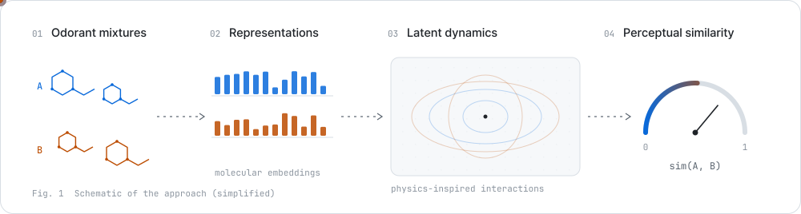
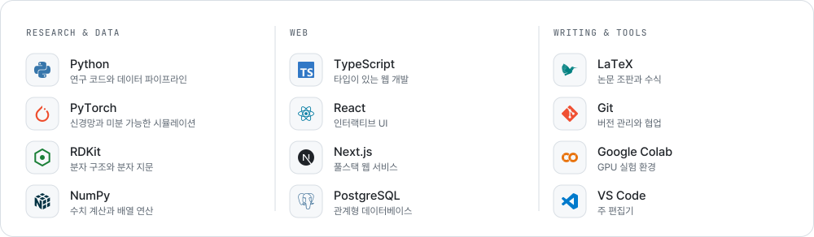

<picture><source media="(prefers-color-scheme: dark)" srcset="./assets/hero-dark.svg"><source media="(prefers-color-scheme: light)" srcset="./assets/hero-light.svg"></picture>

<p align="center">
  <a href="https://orcid.org/0009-0009-1468-9375"><picture><source media="(prefers-color-scheme: dark)" srcset="./assets/badge-orcid-dark.svg"><source media="(prefers-color-scheme: light)" srcset="./assets/badge-orcid-light.svg"></picture></a>
  <a href="https://doi.org/10.1021/acs.jcim.6c01297"><picture><source media="(prefers-color-scheme: dark)" srcset="./assets/badge-paper-dark.svg"><source media="(prefers-color-scheme: light)" srcset="./assets/badge-paper-light.svg"></picture></a>
  <a href="https://github.com/junseong2im/?tab=repositories"><picture><source media="(prefers-color-scheme: dark)" srcset="./assets/badge-repos-dark.svg"><source media="(prefers-color-scheme: light)" srcset="./assets/badge-repos-light.svg"></picture></a>
</p>

<details>
<summary><b>English</b></summary>
<br>

**Junseong Kim** — physics-inspired AI · computational olfaction · software.
I study how people perceive the similarity of odor mixtures, and I build simulations and web services.

- **Paper** — [Physics-Inspired Latent Dynamics for Predicting Olfactory Mixture Similarity](https://doi.org/10.1021/acs.jcim.6c01297), *J. Chem. Inf. Model.* 2026, 66(17), 10584–10592
- **Preprints** — [UMN: Universe Multi Neural Network for Olfactory Mixture Similarity Prediction via Differentiable N-body Simulation](https://doi.org/10.26434/chemrxiv.15001285/v1) · [Physics-Simulated Molecular Interactions Predict Olfactory Perception Without Pretrained Models](https://doi.org/10.26434/chemrxiv.15001664/v1)
- **Projects** — PhysSim (mixture similarity via latent dynamics) · UMN (molecular fingerprints × differentiable N-body simulation) · GravityFluid (early-stage ship design checks) · SPOT. (shared workout schedules)

</details>

### Research · 연구

<a href="https://doi.org/10.1021/acs.jcim.6c01297"><picture><source media="(prefers-color-scheme: dark)" srcset="./assets/figure-dark.svg"><source media="(prefers-color-scheme: light)" srcset="./assets/figure-light.svg"></picture></a>

**물리 기반 잠재 동역학을 활용한 혼합 향 유사도 예측**  
<sub>Physics-Inspired Latent Dynamics for Predicting Olfactory Mixture Similarity</sub>  
김준성 · *Journal of Chemical Information and Modeling* 2026, **66**(17), 10584–10592

여러 분자의 표현을 학습된 잠재 공간에서 변화시켜 혼합 향의 지각적 유사도를 예측합니다. 물리적 상호작용에서 가져온 형태를 학습에 활용합니다.

<p>
  <a href="https://doi.org/10.1021/acs.jcim.6c01297"><picture><source media="(prefers-color-scheme: dark)" srcset="https://raw.githubusercontent.com/junseong2im/junseong2im/output/cite-dark.svg"><source media="(prefers-color-scheme: light)" srcset="https://raw.githubusercontent.com/junseong2im/junseong2im/output/cite-light.svg"></picture></a>
  <a href="https://github.com/junseong2im/PhysSim-Olfactory-Mixture-Similarity"><picture><source media="(prefers-color-scheme: dark)" srcset="./assets/badge-code-dark.svg"><source media="(prefers-color-scheme: light)" srcset="./assets/badge-code-light.svg"></picture></a>
</p>

<details>
<summary>프리프린트와 이전 연구</summary>
<br>

- **UMN** · 미분 가능한 N체 시뮬레이션을 활용한 혼합 향 유사도 예측 — [ChemRxiv · 2026.03](https://doi.org/10.26434/chemrxiv.15001285/v1) · [코드](https://github.com/junseong2im/Universe-Multi-NeuralNetwork)
- **PhysSim** · 물리 모사 기반 분자 상호작용을 활용한 후각 지각 예측 — [ChemRxiv · 2026.04](https://doi.org/10.26434/chemrxiv.15001664/v1) · [코드](https://github.com/junseong2im/PhysSim-Olfactory-Mixture-Similarity)

</details>

### Projects · 프로젝트

<p align="center">
  <a href="https://github.com/junseong2im/PhysSim-Olfactory-Mixture-Similarity"><picture><source media="(prefers-color-scheme: dark)" srcset="https://raw.githubusercontent.com/junseong2im/junseong2im/output/card-physsim-dark.svg"><source media="(prefers-color-scheme: light)" srcset="https://raw.githubusercontent.com/junseong2im/junseong2im/output/card-physsim-light.svg"></picture></a>
  <a href="https://github.com/junseong2im/Universe-Multi-NeuralNetwork"><picture><source media="(prefers-color-scheme: dark)" srcset="https://raw.githubusercontent.com/junseong2im/junseong2im/output/card-umn-dark.svg"><source media="(prefers-color-scheme: light)" srcset="https://raw.githubusercontent.com/junseong2im/junseong2im/output/card-umn-light.svg"></picture></a>
  <a href="https://github.com/junseong2im/GravityFluid"><picture><source media="(prefers-color-scheme: dark)" srcset="https://raw.githubusercontent.com/junseong2im/junseong2im/output/card-gravityfluid-dark.svg"><source media="(prefers-color-scheme: light)" srcset="https://raw.githubusercontent.com/junseong2im/junseong2im/output/card-gravityfluid-light.svg"></picture></a>
  <a href="https://github.com/junseong2im/SPOT"><picture><source media="(prefers-color-scheme: dark)" srcset="https://raw.githubusercontent.com/junseong2im/junseong2im/output/card-spot-dark.svg"><source media="(prefers-color-scheme: light)" srcset="https://raw.githubusercontent.com/junseong2im/junseong2im/output/card-spot-light.svg"></picture></a>
</p>

<a id="blend-demo"></a>

### Blend demo · 혼합 유사도 데모

방문자가 향료를 하나씩 더해 블렌드를 만듭니다. 향료를 고른 뒤 열리는 이슈 화면에서 **Create**를 누르면, GitHub Actions가 블렌드를 갱신하고 직전 블렌드와의 코사인 유사도를 계산해 답글로 알려줍니다.

<p align="center">
  <picture><source media="(prefers-color-scheme: dark)" srcset="https://raw.githubusercontent.com/junseong2im/junseong2im/output/blend-profile-dark.svg"><source media="(prefers-color-scheme: light)" srcset="https://raw.githubusercontent.com/junseong2im/junseong2im/output/blend-profile-light.svg"></picture>
  <picture><source media="(prefers-color-scheme: dark)" srcset="https://raw.githubusercontent.com/junseong2im/junseong2im/output/blend-info-dark.svg"><source media="(prefers-color-scheme: light)" srcset="https://raw.githubusercontent.com/junseong2im/junseong2im/output/blend-info-light.svg"></picture>
</p>

<p align="center">
  <a href="https://github.com/junseong2im/junseong2im/issues/new?title=scent%7Clavender&body=%EC%95%84%EB%9E%98%20%EC%B4%88%EB%A1%9D%EC%83%89%20%2A%2ACreate%2A%2A%20%EB%B2%84%ED%8A%BC%EC%9D%84%20%EB%88%84%EB%A5%B4%EB%A9%B4%20%ED%96%A5%EB%A3%8C%EA%B0%80%20%EB%B8%94%EB%A0%8C%EB%93%9C%EC%97%90%20%EC%B6%94%EA%B0%80%EB%90%A9%EB%8B%88%EB%8B%A4.%20%EC%A0%9C%EB%AA%A9%EC%9D%80%20%EA%B7%B8%EB%8C%80%EB%A1%9C%20%EB%91%90%EC%84%B8%EC%9A%94.%0A%0APress%20%2A%2ACreate%2A%2A%20to%20add%20this%20note.%20Please%20keep%20the%20title%20as%20is."><picture><source media="(prefers-color-scheme: dark)" srcset="./assets/note-lavender-dark.svg"><source media="(prefers-color-scheme: light)" srcset="./assets/note-lavender-light.svg"></picture></a>
  <a href="https://github.com/junseong2im/junseong2im/issues/new?title=scent%7Ccitrus&body=%EC%95%84%EB%9E%98%20%EC%B4%88%EB%A1%9D%EC%83%89%20%2A%2ACreate%2A%2A%20%EB%B2%84%ED%8A%BC%EC%9D%84%20%EB%88%84%EB%A5%B4%EB%A9%B4%20%ED%96%A5%EB%A3%8C%EA%B0%80%20%EB%B8%94%EB%A0%8C%EB%93%9C%EC%97%90%20%EC%B6%94%EA%B0%80%EB%90%A9%EB%8B%88%EB%8B%A4.%20%EC%A0%9C%EB%AA%A9%EC%9D%80%20%EA%B7%B8%EB%8C%80%EB%A1%9C%20%EB%91%90%EC%84%B8%EC%9A%94.%0A%0APress%20%2A%2ACreate%2A%2A%20to%20add%20this%20note.%20Please%20keep%20the%20title%20as%20is."><picture><source media="(prefers-color-scheme: dark)" srcset="./assets/note-citrus-dark.svg"><source media="(prefers-color-scheme: light)" srcset="./assets/note-citrus-light.svg"></picture></a>
  <a href="https://github.com/junseong2im/junseong2im/issues/new?title=scent%7Crose&body=%EC%95%84%EB%9E%98%20%EC%B4%88%EB%A1%9D%EC%83%89%20%2A%2ACreate%2A%2A%20%EB%B2%84%ED%8A%BC%EC%9D%84%20%EB%88%84%EB%A5%B4%EB%A9%B4%20%ED%96%A5%EB%A3%8C%EA%B0%80%20%EB%B8%94%EB%A0%8C%EB%93%9C%EC%97%90%20%EC%B6%94%EA%B0%80%EB%90%A9%EB%8B%88%EB%8B%A4.%20%EC%A0%9C%EB%AA%A9%EC%9D%80%20%EA%B7%B8%EB%8C%80%EB%A1%9C%20%EB%91%90%EC%84%B8%EC%9A%94.%0A%0APress%20%2A%2ACreate%2A%2A%20to%20add%20this%20note.%20Please%20keep%20the%20title%20as%20is."><picture><source media="(prefers-color-scheme: dark)" srcset="./assets/note-rose-dark.svg"><source media="(prefers-color-scheme: light)" srcset="./assets/note-rose-light.svg"></picture></a>
  <a href="https://github.com/junseong2im/junseong2im/issues/new?title=scent%7Cvanilla&body=%EC%95%84%EB%9E%98%20%EC%B4%88%EB%A1%9D%EC%83%89%20%2A%2ACreate%2A%2A%20%EB%B2%84%ED%8A%BC%EC%9D%84%20%EB%88%84%EB%A5%B4%EB%A9%B4%20%ED%96%A5%EB%A3%8C%EA%B0%80%20%EB%B8%94%EB%A0%8C%EB%93%9C%EC%97%90%20%EC%B6%94%EA%B0%80%EB%90%A9%EB%8B%88%EB%8B%A4.%20%EC%A0%9C%EB%AA%A9%EC%9D%80%20%EA%B7%B8%EB%8C%80%EB%A1%9C%20%EB%91%90%EC%84%B8%EC%9A%94.%0A%0APress%20%2A%2ACreate%2A%2A%20to%20add%20this%20note.%20Please%20keep%20the%20title%20as%20is."><picture><source media="(prefers-color-scheme: dark)" srcset="./assets/note-vanilla-dark.svg"><source media="(prefers-color-scheme: light)" srcset="./assets/note-vanilla-light.svg"></picture></a>
  <a href="https://github.com/junseong2im/junseong2im/issues/new?title=scent%7Csandalwood&body=%EC%95%84%EB%9E%98%20%EC%B4%88%EB%A1%9D%EC%83%89%20%2A%2ACreate%2A%2A%20%EB%B2%84%ED%8A%BC%EC%9D%84%20%EB%88%84%EB%A5%B4%EB%A9%B4%20%ED%96%A5%EB%A3%8C%EA%B0%80%20%EB%B8%94%EB%A0%8C%EB%93%9C%EC%97%90%20%EC%B6%94%EA%B0%80%EB%90%A9%EB%8B%88%EB%8B%A4.%20%EC%A0%9C%EB%AA%A9%EC%9D%80%20%EA%B7%B8%EB%8C%80%EB%A1%9C%20%EB%91%90%EC%84%B8%EC%9A%94.%0A%0APress%20%2A%2ACreate%2A%2A%20to%20add%20this%20note.%20Please%20keep%20the%20title%20as%20is."><picture><source media="(prefers-color-scheme: dark)" srcset="./assets/note-sandalwood-dark.svg"><source media="(prefers-color-scheme: light)" srcset="./assets/note-sandalwood-light.svg"></picture></a>
  <a href="https://github.com/junseong2im/junseong2im/issues/new?title=scent%7Cmusk&body=%EC%95%84%EB%9E%98%20%EC%B4%88%EB%A1%9D%EC%83%89%20%2A%2ACreate%2A%2A%20%EB%B2%84%ED%8A%BC%EC%9D%84%20%EB%88%84%EB%A5%B4%EB%A9%B4%20%ED%96%A5%EB%A3%8C%EA%B0%80%20%EB%B8%94%EB%A0%8C%EB%93%9C%EC%97%90%20%EC%B6%94%EA%B0%80%EB%90%A9%EB%8B%88%EB%8B%A4.%20%EC%A0%9C%EB%AA%A9%EC%9D%80%20%EA%B7%B8%EB%8C%80%EB%A1%9C%20%EB%91%90%EC%84%B8%EC%9A%94.%0A%0APress%20%2A%2ACreate%2A%2A%20to%20add%20this%20note.%20Please%20keep%20the%20title%20as%20is."><picture><source media="(prefers-color-scheme: dark)" srcset="./assets/note-musk-dark.svg"><source media="(prefers-color-scheme: light)" srcset="./assets/note-musk-light.svg"></picture></a>
  <a href="https://github.com/junseong2im/junseong2im/issues/new?title=scent%7Cmint&body=%EC%95%84%EB%9E%98%20%EC%B4%88%EB%A1%9D%EC%83%89%20%2A%2ACreate%2A%2A%20%EB%B2%84%ED%8A%BC%EC%9D%84%20%EB%88%84%EB%A5%B4%EB%A9%B4%20%ED%96%A5%EB%A3%8C%EA%B0%80%20%EB%B8%94%EB%A0%8C%EB%93%9C%EC%97%90%20%EC%B6%94%EA%B0%80%EB%90%A9%EB%8B%88%EB%8B%A4.%20%EC%A0%9C%EB%AA%A9%EC%9D%80%20%EA%B7%B8%EB%8C%80%EB%A1%9C%20%EB%91%90%EC%84%B8%EC%9A%94.%0A%0APress%20%2A%2ACreate%2A%2A%20to%20add%20this%20note.%20Please%20keep%20the%20title%20as%20is."><picture><source media="(prefers-color-scheme: dark)" srcset="./assets/note-mint-dark.svg"><source media="(prefers-color-scheme: light)" srcset="./assets/note-mint-light.svg"></picture></a>
  <a href="https://github.com/junseong2im/junseong2im/issues/new?title=scent%7Cmarine&body=%EC%95%84%EB%9E%98%20%EC%B4%88%EB%A1%9D%EC%83%89%20%2A%2ACreate%2A%2A%20%EB%B2%84%ED%8A%BC%EC%9D%84%20%EB%88%84%EB%A5%B4%EB%A9%B4%20%ED%96%A5%EB%A3%8C%EA%B0%80%20%EB%B8%94%EB%A0%8C%EB%93%9C%EC%97%90%20%EC%B6%94%EA%B0%80%EB%90%A9%EB%8B%88%EB%8B%A4.%20%EC%A0%9C%EB%AA%A9%EC%9D%80%20%EA%B7%B8%EB%8C%80%EB%A1%9C%20%EB%91%90%EC%84%B8%EC%9A%94.%0A%0APress%20%2A%2ACreate%2A%2A%20to%20add%20this%20note.%20Please%20keep%20the%20title%20as%20is."><picture><source media="(prefers-color-scheme: dark)" srcset="./assets/note-marine-dark.svg"><source media="(prefers-color-scheme: light)" srcset="./assets/note-marine-light.svg"></picture></a>
</p>

<p align="center"><sub>향 계열 7차원 벡터로 계산한 장난감 모델이며, 논문의 모델과는 다릅니다.</sub></p>

### Activity · 최근 활동

<!-- activity:start -->
```text
loading…
```
<!-- activity:end -->

### Stack · 기술

<picture><source media="(prefers-color-scheme: dark)" srcset="./assets/stack-dark.svg"><source media="(prefers-color-scheme: light)" srcset="./assets/stack-light.svg"></picture>

### GitHub

<p align="center">
  <picture><source media="(prefers-color-scheme: dark)" srcset="https://raw.githubusercontent.com/junseong2im/junseong2im/output/contrib-dark.svg"><source media="(prefers-color-scheme: light)" srcset="https://raw.githubusercontent.com/junseong2im/junseong2im/output/contrib-light.svg"></picture>
  <picture><source media="(prefers-color-scheme: dark)" srcset="https://raw.githubusercontent.com/junseong2im/junseong2im/output/langs-dark.svg"><source media="(prefers-color-scheme: light)" srcset="https://raw.githubusercontent.com/junseong2im/junseong2im/output/langs-light.svg"></picture>
</p>

<p align="center"><sub>Figures are generated by <a href="scripts/build.py"><code>scripts/build.py</code></a> and refreshed daily with GitHub Actions.</sub></p>
