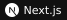

<h1 align="center">김준성 · Junseong Kim</h1>

  <b>물리 기반 AI · 계산 후각 · 소프트웨어</b> 
  혼합 향의 유사도를 연구하고, 시뮬레이션과 웹 서비스를 만듭니다.

  <a href="https://orcid.org/0009-0009-1468-9375">ORCID</a> &nbsp; · &nbsp;
  <a href="https://doi.org/10.1021/acs.jcim.6c01297">JCIM 게재 논문</a> &nbsp; · &nbsp;
  <a href="https://github.com/junseong2im/?tab=repositories">전체 저장소</a>

## 🚀 만들고 있는 것들

| 프로젝트 | 하는 일 | 사용 기술 |
| :-- | :-- | :-- |
| **[PhysSim](https://github.com/junseong2im/PhysSim-Olfactory-Mixture-Similarity)** | 물리 기반 잠재 동역학으로 혼합 향 유사도 예측 | Python · PyTorch · RDKit |
| **[UMN](https://github.com/junseong2im/Universe-Multi-NeuralNetwork)** | 분자 지문과 미분 가능한 N체 시뮬레이션의 연결 | Python · PyTorch · RDKit |
| **[GravityFluid](https://github.com/junseong2im/GravityFluid)** | 선박 초기 설계의 물리 검토와 CFD·FEA 계획 | Python · Taichi · FastAPI |
| **[SPOT.](https://github.com/junseong2im/SPOT)** | 운동 일정 공유와 크루별 맞춤 루틴 관리 | Next.js · TypeScript · PostgreSQL |

## 📖 발표한 연구

**[물리 기반 잠재 동역학을 활용한 혼합 향 유사도 예측](https://doi.org/10.1021/acs.jcim.6c01297)**

김준성 · *Journal of Chemical Information and Modeling*  
2026, **66**(17), 10584–10592

여러 분자의 표현을 학습된 잠재 공간에서 변화시켜 혼합 향의 지각적 유사도를 예측합니다. 물리적 상호작용에서 가져온 형태를 학습에 활용합니다.

[논문 읽기 ↗](https://doi.org/10.1021/acs.jcim.6c01297) &nbsp; [연구 코드 ↗](https://github.com/junseong2im/PhysSim-Olfactory-Mixture-Similarity)

프리프린트와 이전 연구

- **UMN** · 미분 가능한 N체 시뮬레이션을 활용한 혼합 향 유사도 예측  
  [ChemRxiv · 2026.03](https://doi.org/10.26434/chemrxiv.15001285/v1) · [연구 코드](https://github.com/junseong2im/Universe-Multi-NeuralNetwork)
- **PhysSim** · 물리 모사 기반 분자 상호작용을 활용한 후각 지각 예측  
  [ChemRxiv · 2026.04](https://doi.org/10.26434/chemrxiv.15001664/v1) · [연구 코드](https://github.com/junseong2im/PhysSim-Olfactory-Mixture-Similarity)

## 🧰 사용하는 기술

**연구 · 데이터**  
   

**웹 개발**  
   

**기록 · 도구**  
   
