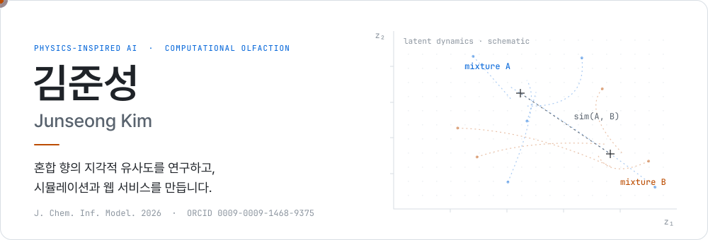
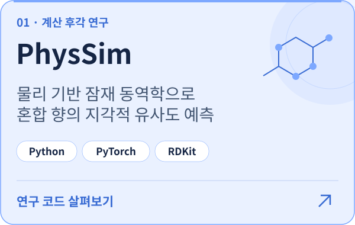
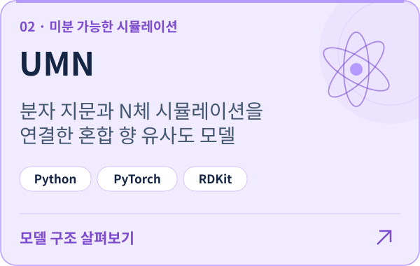
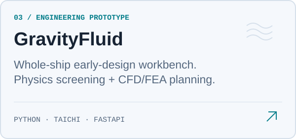

<picture>
  <source media="(max-width: 600px) and (prefers-color-scheme: dark)" srcset="./assets/hero-compact-dark.svg">
  <source media="(max-width: 600px)" srcset="./assets/hero-compact-light.svg">
  <source media="(prefers-color-scheme: dark)" srcset="./assets/hero-dark.svg">
  
</picture>

I explore **physics-inspired AI and computational olfaction**, and turn research ideas into software.

[ORCID](https://orcid.org/0009-0009-1468-9375) · [Published research](https://doi.org/10.1021/acs.jcim.6c01297) · [Selected projects](#selected-projects)

## Selected research

### Physics-Inspired Latent Dynamics for Predicting Olfactory Mixture Similarity

**Junseong Kim** · *Journal of Chemical Information and Modeling* · 2026, 66(17), 10584–10592

Physics-inspired latent dynamics for predicting the perceptual similarity of olfactory mixtures.

[Read the paper ↗](https://doi.org/10.1021/acs.jcim.6c01297) · [Explore the code](https://github.com/junseong2im/PhysSim-Olfactory-Mixture-Similarity)

Earlier preprints &amp; research code

 

**PhysSim: Physics-Simulated Molecular Interactions Predict Olfactory Perception Without Pretrained Models**  
ChemRxiv · April 2026  
[Preprint](https://doi.org/10.26434/chemrxiv.15001664/v1) · [Code](https://github.com/junseong2im/PhysSim-Olfactory-Mixture-Similarity)

**UMN: Universe Multi Neural Network for Olfactory Mixture Similarity Prediction via Differentiable N-body Simulation**  
ChemRxiv · March 2026  
[Preprint](https://doi.org/10.26434/chemrxiv.15001285/v1) · [Code](https://github.com/junseong2im/Universe-Multi-NeuralNetwork)

## Selected projects

  <a href="https://github.com/junseong2im/PhysSim-Olfactory-Mixture-Similarity"><picture>
    <source media="(prefers-color-scheme: dark)" srcset="./assets/physsim-dark.svg">
    
  </picture></a>
  <a href="https://github.com/junseong2im/Universe-Multi-NeuralNetwork"><picture>
    <source media="(prefers-color-scheme: dark)" srcset="./assets/umn-dark.svg">
    
  </picture></a>
  <a href="https://github.com/junseong2im/GravityFluid"><picture>
    <source media="(prefers-color-scheme: dark)" srcset="./assets/gravityfluid-dark.svg">
    
  </picture></a>
  <a href="https://github.com/junseong2im/SPOT"><picture>
    <source media="(prefers-color-scheme: dark)" srcset="./assets/spot-dark.svg">
    
  </picture></a>

[View all repositories ↗](https://github.com/junseong2im?tab=repositories)

## Toolbox

**Research** · Python · PyTorch · RDKit · NumPy  
**Web** · TypeScript · React · Next.js · PostgreSQL  
**Writing** · LaTeX  
**Workflow** · Git · GitHub · Google Colab · VS Code

---

<samp>idea → experiment → code</samp>
