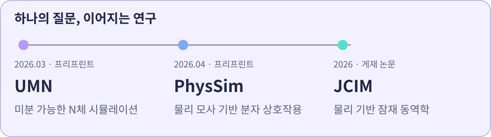
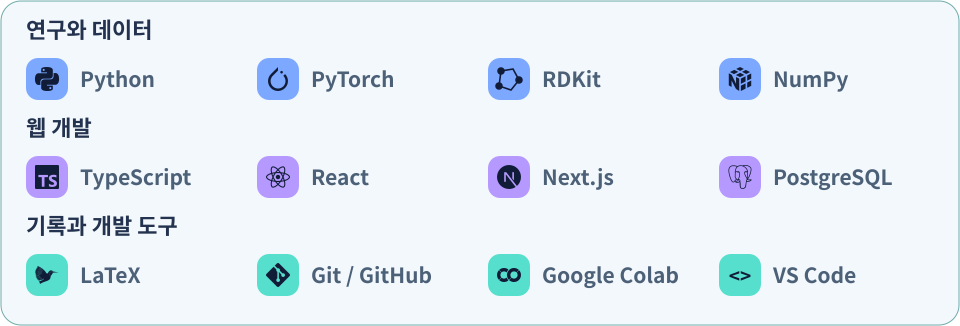

<picture>
  <source media="(max-width: 600px) and (prefers-color-scheme: dark)" srcset="./assets/hero-compact-dark.svg">
  <source media="(max-width: 600px)" srcset="./assets/hero-compact-light.svg">
  <source media="(prefers-color-scheme: dark)" srcset="./assets/hero-dark.svg">
  
</picture>

  <b>물리 기반 AI와 계산 후각을 탐구하고, 연구 아이디어를 소프트웨어로 구현합니다.</b> 
  분자와 향의 관계를 모델링하는 연구부터, 시뮬레이션과 웹 서비스 개발까지.

  
  
  

## 🧬 향을 이해하기 위한 연구

### 물리 기반 잠재 동역학을 활용한 혼합 향 유사도 예측

**김준성** · *Journal of Chemical Information and Modeling*  
**2026 · 66(17) · 10584–10592**

분자의 물리적 상호작용에서 아이디어를 얻어, 여러 향이 섞였을 때 사람이 느끼는 **지각적 유사도**를 예측합니다. 물리 기반 잠재 동역학을 후각 혼합물 모델링에 연결한 연구입니다.

[📖 게재 논문 읽기](https://doi.org/10.1021/acs.jcim.6c01297) · [💻 연구 코드 살펴보기](https://github.com/junseong2im/PhysSim-Olfactory-Mixture-Similarity)

<picture>
  <source media="(max-width: 600px) and (prefers-color-scheme: dark)" srcset="./assets/research-compact-dark.svg">
  <source media="(max-width: 600px)" srcset="./assets/research-compact-light.svg">
  <source media="(prefers-color-scheme: dark)" srcset="./assets/research-dark.svg">
  
</picture>

- **UMN · 2026년 3월 프리프린트**  
  미분 가능한 N체 시뮬레이션을 활용한 혼합 향 유사도 예측  
  [프리프린트](https://doi.org/10.26434/chemrxiv.15001285/v1) · [코드](https://github.com/junseong2im/Universe-Multi-NeuralNetwork)
- **PhysSim · 2026년 4월 프리프린트**  
  사전학습 모델 없이 물리 모사 기반 분자 상호작용으로 후각 지각 예측  
  [프리프린트](https://doi.org/10.26434/chemrxiv.15001664/v1) · [코드](https://github.com/junseong2im/PhysSim-Olfactory-Mixture-Similarity)

## 🚀 주요 프로젝트

연구 모델, 공학 시뮬레이션, 그리고 일상에서 쓰는 웹 서비스입니다. 카드를 누르면 각 저장소로 이동합니다.

<a href="https://github.com/junseong2im/PhysSim-Olfactory-Mixture-Similarity"><picture><source media="(prefers-color-scheme: dark)" srcset="./assets/physsim-dark.svg"></picture></a>
&nbsp;
<a href="https://github.com/junseong2im/Universe-Multi-NeuralNetwork"><picture><source media="(prefers-color-scheme: dark)" srcset="./assets/umn-dark.svg"></picture></a>

<a href="https://github.com/junseong2im/GravityFluid"><picture><source media="(prefers-color-scheme: dark)" srcset="./assets/gravityfluid-dark.svg"></picture></a>
&nbsp;
<a href="https://github.com/junseong2im/SPOT"><picture><source media="(prefers-color-scheme: dark)" srcset="./assets/spot-dark.svg"></picture></a>

[모든 프로젝트 둘러보기 ↗](https://github.com/junseong2im?tab=repositories)

## 🛠️ 사용하는 기술과 도구

<picture>
  <source media="(max-width: 600px) and (prefers-color-scheme: dark)" srcset="./assets/toolbox-compact-dark.svg">
  <source media="(max-width: 600px)" srcset="./assets/toolbox-compact-light.svg">
  <source media="(prefers-color-scheme: dark)" srcset="./assets/toolbox-dark.svg">
  
</picture>

 

<picture>
  <source media="(max-width: 600px)" srcset="./assets/footer-compact.svg">
  
</picture>
