  
  
  

 

  
  
  
  

  
  

<b>프리프린트와 이전 연구</b>

 

- **UMN** · 미분 가능한 N체 시뮬레이션을 활용한 혼합 향 유사도 예측  
  [ChemRxiv · 2026.03](https://doi.org/10.26434/chemrxiv.15001285/v1) · [연구 코드](https://github.com/junseong2im/Universe-Multi-NeuralNetwork)
- **PhysSim** · 물리 모사 기반 분자 상호작용을 활용한 후각 지각 예측  
  [ChemRxiv · 2026.04](https://doi.org/10.26434/chemrxiv.15001664/v1) · [연구 코드](https://github.com/junseong2im/PhysSim-Olfactory-Mixture-Similarity)

 

